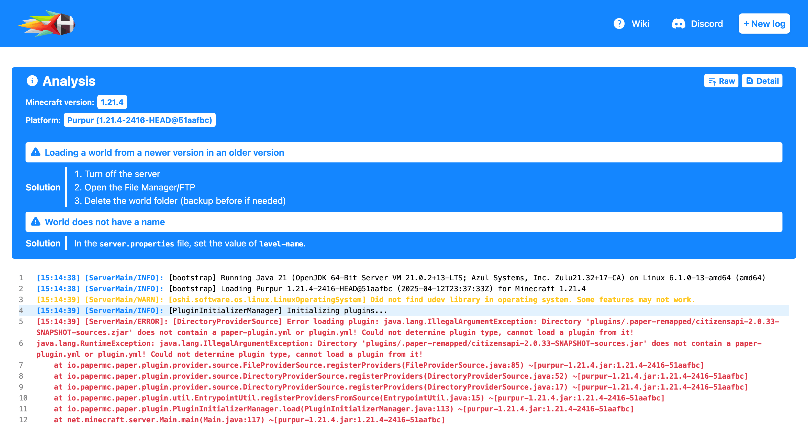
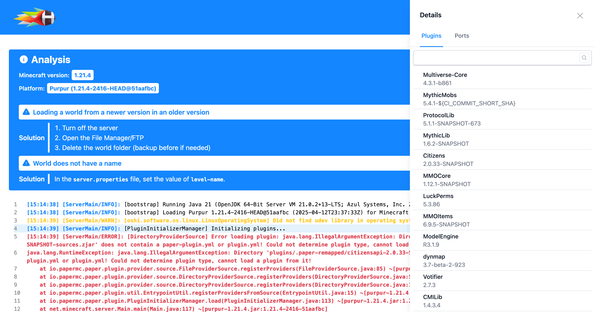
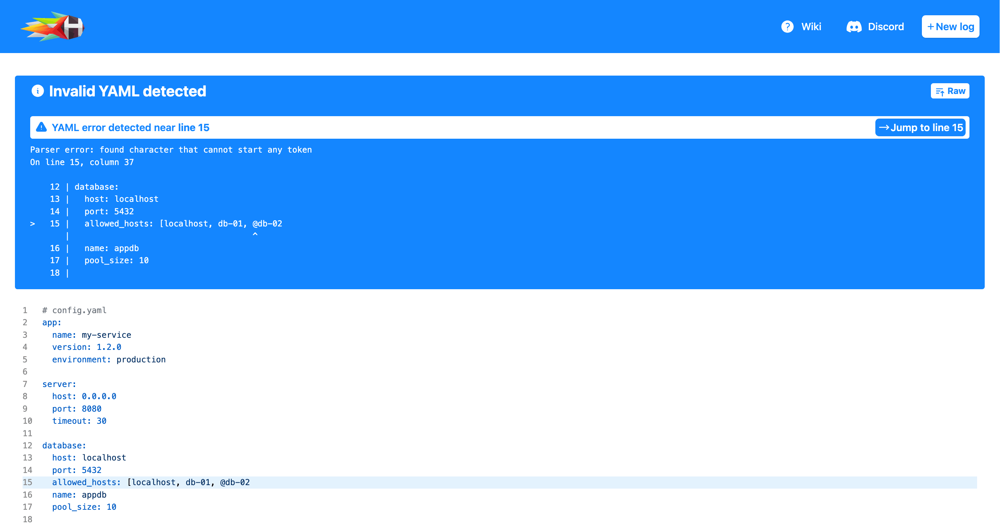
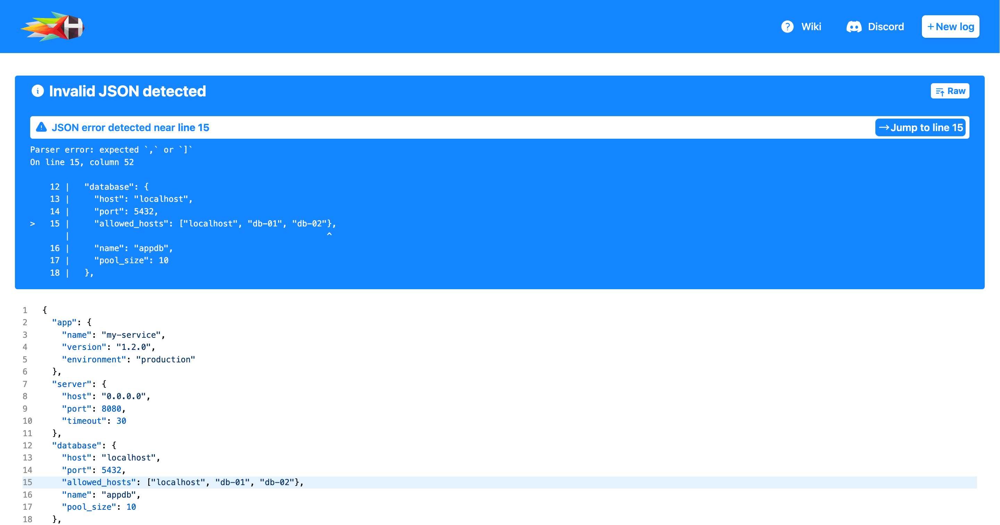

# copycat
copycat is a pastebin service mainly for Minecraft servers written in Rust and built on top of [mclog](https://github.com/caukub/mclog), a library responsible for parsing and extracting information from the log.

Thanks to the advanced [mclog's](https://github.com/caukub/mclog) static analyzer and [dynamic analyzer](https://github.com/caukub/copycat/wiki/Analyzer) powered by JavaScript, you can easily get information about a server and give the users solutions on how to solve issues based on it.

<table>
  <tr>
    <td align="center" width="50%">
      
       
    </td>
    <td align="center" width="50%">
      
       
    </td>
  </tr>
</table>

<table>
  <tr>
    <td align="center" width="50%">
      
       
    </td>
    <td align="center" width="50%">
      
       
    </td>
  </tr>
</table>

## Motivation
After reading hundreds of Minecraft logs, I've seen *a lot* of repetition that I wanted to automate. Unfortunately, all existing alternatives didn't fit our needs, mainly because of the lack of flexibility in detecting errors and solutions for them.

That's why copycat has a [dynamic analyzer](https://github.com/caukub/copycat/wiki/Analyzer#Dynamic) which allows you to write custom detection scripts based on many factors like the server info, plugin info, or the log content itself.

## Features
**Note:** All features are not implemented yet since [mclog](https://github.com/caukub/mclog) has been rewrited.

### Static analyzer
Static analyzer gives you some basic information about the log, this includes:
- [x] Highlighting - different highlighting for info/warn/error messages, also higlighting for different specific messages without the log level (usually host panel messages) is supported.

This works with 0 lines of JavaScript and supports different platform/hosting formats, so all following `INFO]:`, `INFO:` or `INFO]` formats will be highlighted properly (not limited to these, suffix is detected dynamically).
- [x] Server info (version, platform, platform version)
- [x] Plugin info (if present, version)
- [x] Port info - info about the server (server, query, RCON), plugin and mod ports.

### Dynamic analyzer
You can write custom detection scripts based on information that is provided by a static analyzer. You can see examples in [/scripts/](/scripts/).

### API
Thanks to the developer API, you can easily integrate copycat with different platforms like Discord or a hosting panel.

### IP address hider
IP addresses are hidden but plugin or server related versions that matches IP addresses are not.

### Line highlighting (linking)
As you can see in the first screenshot, you can select a specific line to jump to when the page opens.

## JSON and YAML support
copycat also support Y(A)ML and JSON files so configuration files can be displayed properly.

**If content should be JSON/YAML but the format is invalid, parser error is shown** (thanks to [magika](https://github.com/google/magika)).

### No JavaScript
Almost all of these features works without JavaScript enabled.

## Installation
### Default
Requirements: C/C++ toolchain (Xcode Command Line Tools - `xcode-select --install` on macOS, `g++`, `pkg-config` and OpenSSL headers - `libssl-dev` on Linux)

1) Install Rust using the `curl --proto '=https' --tlsv1.2 -sSf https://sh.rustup.rs | sh` command
2) Clone the repository using the `git clone https://github.com/caukub/copycat.git` command and `cd` into it
3) Download [Tailwind Standalone CLI ](https://github.com/tailwindlabs/tailwindcss/releases), rename the executable to `tailwind`, make it executable using `chmod +x tailwind` command, put it in the project directory and generate the CSS using `./tailwind -m -i frontend/assets/input.css -o frontend/assets/styles.css` command
4) Build the project using `cargo build --release` command and run it with `cargo run --release`

### Docker
1) Clone the repository using following command: `git clone https://github.com/caukub/copycat.git` and `cd` into it
2) Build the Docker image using `docker build -t copycat .` command
3) Start the container using `docker run -p 3000:3000 -v ./configuration:/app/configuration -v ./data:/app/data copycat` command

### Nix
1) Clone the repository using following command: `git clone https://github.com/caukub/copycat.git` and `cd` into it
2) Enable `nix-command flakes` experimental feature using `mkdir -p ~/.config/nix && echo "experimental-features = nix-command flakes" >> ~/.config/nix/nix.conf` command if not enabled already
3) Run the flake using `nix run` command

## TODO
- Log entry type in script with callback support

## Special thanks
- [kyngs](https://github.com/kyngs) for the name idea.
